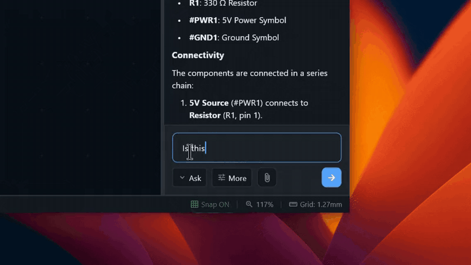
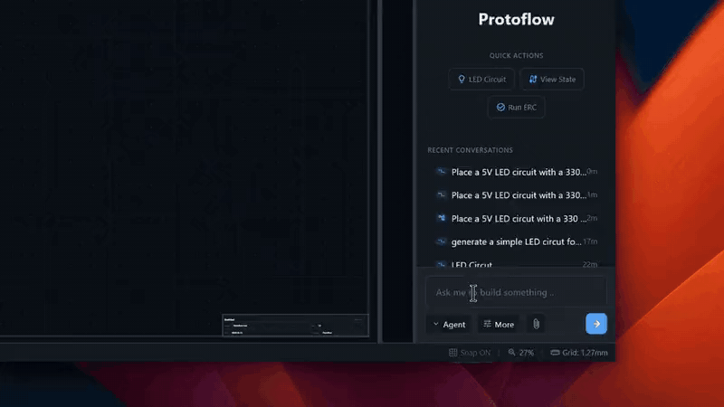
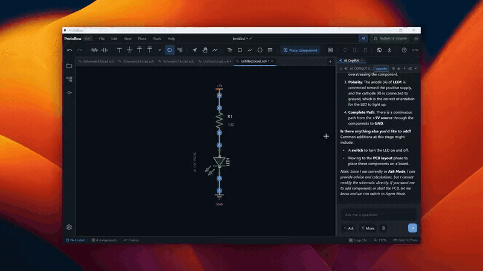

# AI assistant

The **AI Copilot** panel is where you talk to ProtoFlow's AI. It can build a schematic from a description, make targeted edits, place and route a board, and answer questions about your design. It works on the schematic or board in the tab you have open.

## Open the AI Copilot

Click **AI** at the right end of the top bar (tooltip **Toggle AI Copilot**). Click it again to hide the panel. You can also use the menu: **View** > **Panels** > **AI Copilot** on macOS, or **View** > **AI Copilot** on Windows and Linux.

The panel's header says what the AI is working on, for example **AI Copilot for Schematics** or **AI Copilot for PCBs**.

## Choose a mode

The mode menu sits at the bottom of the panel, next to the **+** button (tooltip **Conversation mode**).

| Mode | What it does |
|---|---|
| **Standard** | Fast building and editing. Builds an empty schematic from a description, edits one that has parts, and works on boards. Best for new prompts and focused changes. |
| **Ask** | Only answers questions. It reads your design but never changes it. |
| **Max (Studio)** | ProtoFlow's most capable builder: parts, schematic, layout, routing and checks for a whole board. See [Max mode](max-mode.md). |

Standard also answers plain questions, so you only need **Ask** when you want to be sure nothing changes.

## Write a prompt

Type in the box at the bottom of the panel and press <kbd>Enter</kbd>, or click the send button. Be specific about parts, values, voltages and how things connect.

Example prompts in Standard mode:

- "Build a 5 V to 3.3 V regulator with an LDO, input and output capacitors, and a power LED."
- "Add a 10k pull-up from the I2C SDA and SCL lines to 3.3 V."
- "Connect the SPI bus between U1 and the ADC."
- "Change R4 to 4.7k."
- On a board: "Put the USB connector on the left edge."

If no project is open when you send your first prompt, ProtoFlow creates one for you. A **Creating project** card shows the proposed **Project name**, **Save location** and **Description**. Click **Accept**, or **Decline** to stop. The card accepts on its own after a short countdown.

### Mention a part or net

Type <kbd>@</kbd> to pick a part or net from the design, so the AI knows exactly which one you mean.

### Attach files

Click **+** (tooltip **Attach image or PDF (or Ctrl+V to paste)**) or drag files onto the panel. You can also paste an image with <kbd>Cmd</kbd>/<kbd>Ctrl</kbd>+<kbd>V</kbd>.

- **Images** (PNG, JPG, GIF, WebP): a photo of a hand-drawn schematic, a screenshot, a reference circuit.
- **PDFs**: the AI reads a datasheet's text directly to answer your question, and searches long datasheets for the pages it needs.
- **Max mode** takes any file type.

Attaching files needs a paid plan. See [pricing](https://www.protoflow.ai/pricing).

### Voice input

Click the microphone to dictate your prompt. Speech is turned into text on your computer; the first time, ProtoFlow downloads the speech model. Click the microphone again to stop, or click the send button (tooltip **Stop recording and send**) to stop and send in one step. Voice input needs a paid plan.

## Model and effort

The pill next to the send button shows the current model and effort (tooltip **Model & effort settings**). Click it to change:

| Row | What it sets |
|---|---|
| **Model** | Which AI model answers. |
| **Effort** | How long the model thinks before it answers. Higher effort is slower and more thorough. |
| **Permissions** | **Allow all edits** applies changes right away. **Ask before edits** shows each change for you to approve first. |
| **Questions** | **Ask me** stops for decisions; **Use recommended** takes the AI's recommended answer and keeps going. |

The **Model** menu starts with four simple choices:

| Choice | Best for |
|---|---|
| **Basic** | Quick edits and simple changes |
| **Fast** | One clear task at a time; follows exactly what you ask |
| **Pro** | Fast and capable; good for quick design work |
| **Advanced** | Complex designs; reasons hardest and asks more questions |

Each model shows its relative cost, such as **1×**. Click **Show all models** to choose a specific model, or search the full list. Some models and higher effort levels need a paid plan; a lock icon marks them. See [pricing](https://www.protoflow.ai/pricing).

### Local models

On a paid plan, Standard mode can run on a model on your own computer through Ollama or LM Studio, without using credits. Set it up in **Settings** > **Local models**, then pick the model under **On your computer** in the **Model** menu.

## While the AI works

The chat shows each step as it happens, such as **Searching components**, **Placing components** or **Checking the design**, and the canvas updates as the AI edits. A step shown in amber didn't work; the AI usually tries another way and keeps going.

- **Stop:** click the red stop button next to the send button.
- **Queue a message:** press <kbd>Enter</kbd> while the AI is working. The message waits and sends when the run ends.
- **Steer:** press <kbd>Shift</kbd>+<kbd>Enter</kbd> to interrupt and send your message now.

You can swap these two keys in **Settings** > **Input** with **Swap queue / steer shortcuts**.

### Questions from the AI

When the AI needs a decision that changes the hardware, it shows a question card with a few options, one marked as recommended. Click an option to answer. To stop the cards, set **Questions** to **Use recommended** in the settings pill.

### Approving changes

- With **Ask before edits**, the AI shows its changes and waits for you to approve them.
- If an edit has to reach beyond the parts you asked about, the AI stops on a **Waiting for your approval** card that explains why.
- If a change would touch a part you locked with **Lock in Place**, the AI asks first. Click **Unlock & continue** or **Keep locked**.

## Undo and restore

Hover over one of your messages and click the undo arrow (tooltip **Restore to this point**). ProtoFlow rewinds the AI's changes made since that message and puts the message back in the input box, so you can edit it and send it again.

When you resend, the new answer becomes another version of that exchange. Use the arrows on the message to switch between versions; the design switches with them.

You can also double-click one of your messages to edit it.

## Conversations and AI tabs

Conversations are saved automatically and belong to the project or file you were working on.

- **Conversations** (header button) lists past conversations. Open one to continue it.
- **New AI tab** starts a fresh chat in its own tab at the top of the panel.

You can run several AI chats side by side, each in its own tab. Each one works on its own files, so two chats never overwrite each other's changes.

## Schematic options

On a schematic, the gear button in the composer (tooltip **Show advanced options (scope, annotations, wiring)**) shows more settings:

| Setting | Choices |
|---|---|
| **Schematic scope** | **This schematic only**, or **Allow multiple schematics** so the AI can create and open other sheets |
| **Annotations** | **Annotations** lets the AI add notes, shapes and section outlines; **No annotations** stops it |
| **Connection style** | **Auto**, **Direct Wires** or **Net Labels** |

Changing these needs a paid plan.

## Diagrams in the chat

Ask for a block diagram or flowchart and the AI draws it in the chat. Click **Open in diagram editor** on the diagram to open it in its own tab, where you can edit it on a canvas or in its source.

## Usage

AI use is measured in credits. Each plan includes an allowance, and you can buy more credits. See [pricing](https://www.protoflow.ai/pricing). The panel's **Usage** button shows what you have used.

## Related

- [Max mode](max-mode.md)
- [What the AI can do](ai-tools.md)
- [Datasheet viewer](datasheet-viewer.md)
- [Component Lab](component-lab.md)
