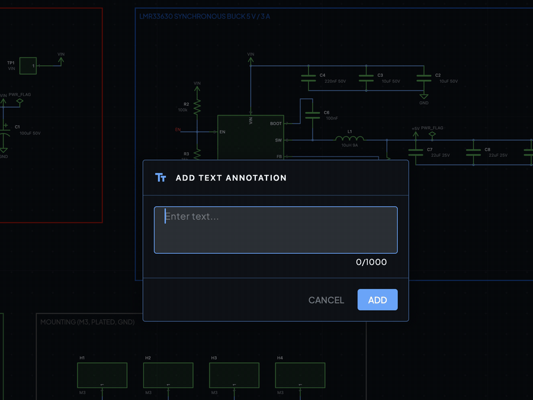

# Annotations and regions

Annotations are notes and drawings on the schematic that have no electrical meaning. Use text, shapes and named sections to explain a design, group its blocks and leave instructions for whoever reads it next.

## Text

1. Press <kbd>T</kbd>, or click **Text** in the toolbar.
2. Click the canvas where the note should go.
3. In **ADD TEXT ANNOTATION**, type your note.
4. Press <kbd>Enter</kbd> or click **ADD**.

To change the words later, double-click the note. To change how it looks, select it and open **Properties**. Under **Text** you can set the **Font** (**Mono**, **Sans** or **Serif**), the **Size** and the **Align** option.

## Shapes

Use rectangles, lines and circles to highlight an area or draw attention to a part.

1. Click **Shapes** in the toolbar.
2. Under **SHAPES**, choose **Rectangle**, **Line** or **Circle**. In the same menu you can set the **COLOR**, **LINE STYLE** and **THICKNESS** (**Thin**, **Normal** or **Thick**). If shapes are selected, the change applies to them too.
3. Press, drag and release on the canvas to draw the shape. You can also click once for the first corner and again for the second.

Select a shape to move it, resize it with its handles, or delete it with <kbd>Delete</kbd>. The **Properties** panel shows:

| Section | Settings |
| --- | --- |
| **Geometry** | Center and size for rectangles (plus **Corner radius**), center and **Radius** for circles, **Start**, **End** and **Length** for lines. Values are in millimetres. |
| **Stroke** | **Color**, **Width** and **Style**: solid, dashed, dotted, dash-dot or dash-dot-dot. |
| **Fill** | Turn the fill on, then pick its **Color** and **Opacity**. Shown for shapes that can be filled. |

Shapes have no keyboard shortcuts. <kbd>Shift</kbd>+<kbd>R</kbd> rotates the selection counterclockwise, it does not draw a rectangle.

## Sections

A section is a named box drawn around one block of the circuit, such as "Power supply" or "USB". Sections make a large schematic easier to read, and the AI uses them to label the blocks it builds.

1. Click **Section** in the toolbar. Its tooltip reads "Section: draw a named box around part of the sheet".
2. Drag a box around the parts that belong together. ProtoFlow names it **Section 1**, **Section 2** and so on.
3. With the section selected, open **Properties** to rename it.

Drag a section's edges or corners to resize it, or drag the section to move it. Its **Properties** include:

| Section | Settings |
| --- | --- |
| **Section** | **Name** and **Description** |
| **Box** | **Position** and **Size** |
| **Title** | Where the name sits: **Side** (**Top**, **Right**, **Bottom** or **Left**), **Align**, **Inside box**, **Size**, bold, **Padding** and **Title box** |

## Control what the AI adds

By default the AI may add text, shapes and section outlines when it builds a schematic. To change that, open the advanced options under the **AI Copilot** message box and set **Annotations** to **Annotations** or **No annotations**. On the free plan this setting is locked. See [protoflow.ai/pricing](https://www.protoflow.ai/pricing).

## Related

- [Schematic editor](schematic-editor.md)
- [AI assistant](ai-assistant.md)
- [Comments and reviews](comments-and-reviews.md)
