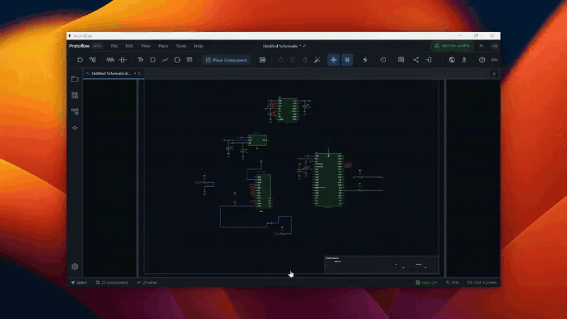

# Live Collaboration

Live collaboration lets you share open schematics and boards with other ProtoFlow users and edit them together in real time. Each person sees the others' cursors, and edits merge automatically.

Live collaboration needs a paid plan (see [pricing](https://www.protoflow.ai/pricing)) and works in the macOS and Windows apps. Everyone in a session must be signed in.

## Start a session

1. Open the schematic or board you want to share.
2. Click **Share Session** (the share icon) in the schematic or PCB toolbar. You can also run **Share Session** from the command palette (<kbd>Cmd</kbd>/<kbd>Ctrl</kbd>+<kbd>Shift</kbd>+<kbd>P</kbd>).
3. Under **What do you want to share?**, pick a scope:
   - **Single file**: one schematic or board.
   - **Selected files**: specific schematics and boards you check.
   - **Entire project**: all open schematic and board files.
4. Click **Start Sharing**.

ProtoFlow creates the session and shows how others can join:

- **SESSION PIN**: a 6-digit code. Click it to copy it.
- **Scan to join**: a QR code for the session.
- **Copy link**: copies an invite link for the session.
- **Invite by email (in-app)**: type a collaborator's email and click **Send in-app invite**. They get an invite prompt inside ProtoFlow the next time they are online.

Symbols and footprints open in their editors can be shared too. Run **Share Session** from the command palette while one is active.

## Choose what collaborators can do

Under **Anyone who joins can**, pick an access level:

| Access | What the person can do |
| --- | --- |
| **Editor** | Edit, comment, and chat |
| **Commenter** | Comment and chat, but not edit |
| **Viewer** | Only view the shared files |

The host always has full access. **People with access** lists everyone you invited.

## Join a session

- **With a PIN**: click **Join Session** (the sign-in arrow icon next to **Share Session**), enter the 6-digit PIN, and click **Join Session**.
- **With an in-app invite**: accept the invite prompt that appears in ProtoFlow.

The shared files open in your editor. If joining fails, ProtoFlow tells you why, for example when the PIN is wrong or the session has expired. Ask the host for a new PIN in that case.

## During a session

While you are in a session, the toolbar shows the session status in place of the Share and Join buttons: **Live with** and the other person's name, or **Connecting...**, **Reconnecting...**, or **Disconnected**.

Click the status to open the session menu:

- **Session:** shows the PIN. Guests also see **Your access:** with their role.
- The host can change what the collaborator can do. The change applies right away.
- **Follow** a collaborator to have your view track their cursor. Choose **Stop Following** to stop.
- **Leave Session** disconnects you.

Each collaborator's cursor appears on the canvas with their name. Edits from everyone are applied in the same order on every computer, so you never have to merge changes by hand.

## End or leave a session

- A guest chooses **Leave Session** and confirms. They stop receiving live changes.
- When the host leaves, the session ends and everyone is disconnected. The host's document stays open with its current contents. The command palette also has **End Shared Session** for the host and **Leave Shared Session** for guests.

If you close a shared tab while hosting, ProtoFlow asks before it ends the session.

## Related

- [Comments and reviews](comments-and-reviews.md)
- [Version control](version-control.md)
- [Schematic editor](schematic-editor.md)
- [PCB editor](pcb-editor.md)
