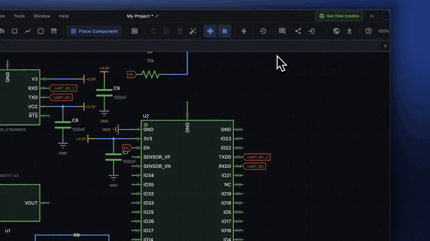

# Comments and Reviews

Comments let you leave notes on a schematic, anchored to the parts, wires, and labels they are about. You can also ask the AI to review a schematic and list problems it finds.

## Add a comment

1. Turn on the comment tool. Click **Comment (drag to select)** (the speech-bubble icon) in the schematic toolbar, or run **Add Comment** from the command palette (<kbd>Cmd</kbd>/<kbd>Ctrl</kbd>+<kbd>Shift</kbd>+<kbd>P</kbd>).
2. Drag a box around the parts, wires, or labels you want to comment on.
3. Type your note in the **Add a comment...** box that appears next to the selection.
4. Press <kbd>Enter</kbd> to add it. Press <kbd>Esc</kbd> to cancel.

While the comment tool is on, the status bar shows **Drag to comment**. Click **Exit Comment Mode**, click anywhere without dragging, or press <kbd>Esc</kbd> to go back to normal selection.

## Read comments

Comments appear as cards along the left and right edges of the sheet, with a line to the area they are about. Each card shows the author and the date. The cards move with the canvas when you pan and zoom.

## Edit, resolve, and delete

Right-click a comment card:

- **Edit** changes the text. Click **Save** to keep the change.
- **Resolve** marks the comment as handled. The card shows **Resolved**. Choose **Unresolve** to reopen it.
- **Delete** removes the comment.

## Where comments are saved

Comments are saved inside the schematic file (`.kicad_sch`). They travel with the file when you share it or commit it to Git. ProtoFlow stores them as a hidden text item placed off the sheet, so KiCad still opens the file normally.

## Comments in a live session

In a [live collaboration](collaboration.md) session, everyone sees new comments as they are added. A collaborator with **Commenter** access can comment but not edit the design.

## Ask the AI for a review

You can ask the AI Copilot to review the schematic that is open, for example "Review this schematic for problems". The review comes back in the chat as a **Schematic review** card that lists what it found:

- Findings checked against a part's datasheet are marked **Verified against the part datasheet**.
- A finding with a suggested change has a **Fix** button that asks the AI to make that change.
- **New chat** starts a separate conversation about one finding.

A review does not change your design by itself. Changes happen only when you ask for a fix. The AI review is separate from canvas comments: findings stay in the chat and are not added as comment cards.

For automatic rule checks such as ERC and DRC, see [Design checks](design-checks.md).

## Related

- [Collaboration](collaboration.md)
- [AI assistant](ai-assistant.md)
- [Design checks](design-checks.md)
- [Schematic editor](schematic-editor.md)
