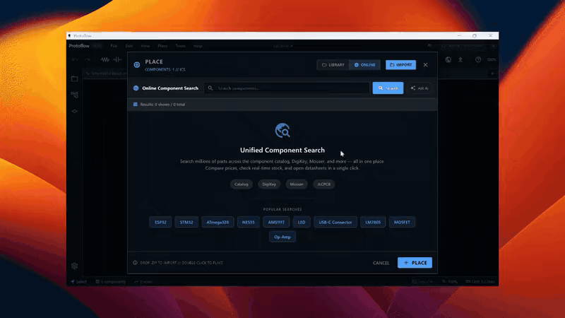
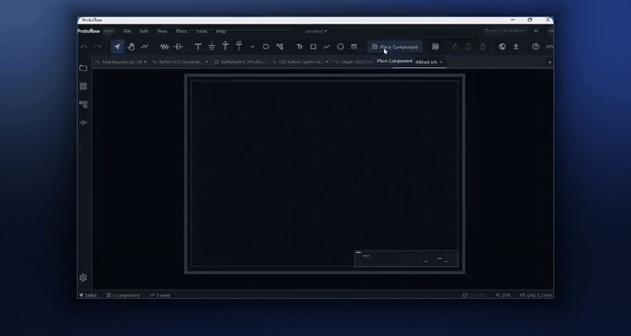
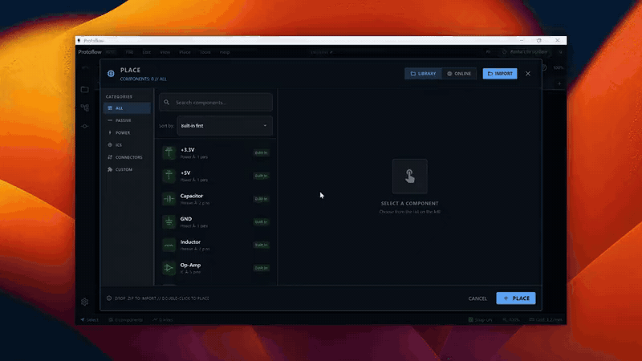

# Components and parts

ProtoFlow gives you three ways to add parts: single-key shortcuts for common symbols, the **Components** panel, and the **Place Component** search, which finds real, orderable parts in the LCSC / JLCPCB catalog and in KiCad's official library.

## Quick-place common parts

Press a key while the schematic canvas has focus, then click to place the part. Press <kbd>R</kbd> while a part is following the cursor to rotate it before you drop it. Press <kbd>Esc</kbd> when you are done placing.

| Key | Places |
| --- | --- |
| <kbd>R</kbd> | Resistor (when nothing is selected; with a selection, <kbd>R</kbd> rotates) |
| <kbd>C</kbd> | Capacitor |
| <kbd>I</kbd> | Inductor |
| <kbd>O</kbd> | Op-amp |
| <kbd>V</kbd> | VCC power symbol |
| <kbd>D</kbd> | GND ground symbol |
| <kbd>5</kbd> | +5V power symbol |
| <kbd>3</kbd> | +3.3V power symbol |
| <kbd>X</kbd> | No-connect marker |

You can change these keys, and give your own library parts a key, in the **Components** panel. See [Assign your own keys](#assign-your-own-keys).

The toolbar also has buttons for **Resistor**, **Capacitor**, the power symbols, a **Test Point** and a **Mounting Hole**.

ProtoFlow numbers parts for you as you place them, for example R1, R2 and C1.

## The Components panel

Open **Components** from the panel icons at the window edge, or choose **View > Component Library**.

The panel has filter chips across the top:

- **Online** searches the parts catalog. Type a part name or number and press <kbd>Enter</kbd>. Results show stock and a datasheet link, and you can download a part into your library.
- **All**, **Passives**, **ICs** and **Power** list the built-in symbols.
- **Downloaded** and **Custom** list parts you downloaded, imported or created.

Click a part to place it. Shift+click a library part to preview it first.

### Assign your own keys

1. In the **Components** panel, right-click a part.
2. Choose **Configure Keybind**.
3. Press a letter or number key. Modifier keys are not allowed.

To remove a key, right-click the part and choose **Clear Keybind**. A few keys are reserved for tools: <kbd>S</kbd> (Select), <kbd>W</kbd> (Wire), <kbd>L</kbd> (Net Label), <kbd>M</kbd> (Mirror), <kbd>T</kbd> (Text) and <kbd>G</kbd> (Grid). <kbd>R</kbd> can only be used for the resistor.

## Search for real parts with Place Component

Press <kbd>Ctrl</kbd>+<kbd>Space</kbd> (on macOS too) or click **Place Component** in the toolbar. The search window has two tabs, **ONLINE** and **LIBRARY**, and an **IMPORT** button.

### Search online

1. On the **ONLINE** tab, pick a source: **LCSC / JLCPCB** for the orderable parts catalog, or **KiCad Library** for KiCad's official parts.
2. Type a part number, a value or a package, for example `10k 0603` or `LDO 3.3`.
3. Narrow the results with the filters on the left: category, stock, package and manufacturer. The counts update as you go.
4. Click a result to check it. The details show the part's symbol, footprint and 3D model in **Part Preview**, plus model, manufacturer, description, price and stock, and a link to its product page.
5. Double-click the result, or click **PLACE**, to put it on the schematic.

Use **Open Datasheet** to read the datasheet. If a part has none on file, **Find Datasheet** looks for one, and you can add a link or attach a PDF yourself.

### Describe a part with Ask AI

If you do not know the part number, type a plain description in the **Describe a part...** box and click **Ask AI**, for example "a 3.3 V regulator that can do 500 mA from USB". The AI builds a shortlist of matching parts for you to compare and place.

### Your library

Parts you downloaded or imported appear on the **LIBRARY** tab. Click one to edit its details, add a datasheet, or let the AI fill in missing information. From **Part Preview** you can also open the symbol in the [Symbol editor](symbol-editor.md) or the footprint in the [Footprint editor](footprint-editor.md).

## Import parts from files

- In the **Place Component** window, click **IMPORT** and pick a `.zip` part package, such as the KiCad symbol, footprint and 3D model a part vendor provides.
- Or choose **File > Import Component...** and pick a `.kicad_sym`, `.sym`, `.lib`, `.kicad_mod`, `.mod` or `.zip` file. Symbol and footprint files open a review dialog before the part is added.

Imported parts are saved to your library so you can reuse them in other projects.

## Edit a placed part

Select a part and press <kbd>P</kbd>, or double-click a built-in part, to open the **Properties** panel. Double-clicking a library part opens its symbol in the [Symbol editor](symbol-editor.md) instead.

The **Properties** panel groups the settings:

| Section | Settings |
| --- | --- |
| **Part** | **Reference** and **Value**. Capacitors also show the dielectric. |
| **Placement** | **Position**, **Rotation** (0°, 90°, 180° or 270°) and **Mirrored**. |
| **Physical part** | For resistors and capacitors: **Package**, **Tolerance** (resistors) or **Voltage** (capacitors), and the **Footprint**. |
| **Pins** | Show or hide pin **Numbers** and **Names** on the canvas. |

For resistors and capacitors, ProtoFlow searches the parts catalog for a real part that matches the value and package. The **Catalog** badge shows **Matched**, **No exact part**, **Lookup failed** or **Resolving**. When there is a match, the panel shows its **LCSC** number, **Manufacturer** and **MPN**.

To hide or show a part's reference or value text on the canvas, click the text and press <kbd>V</kbd>.

## Create new parts

- Draw your own symbol in the [Symbol editor](symbol-editor.md) with **File > New > Symbol**.
- Draw a footprint in the [Footprint editor](footprint-editor.md) with **File > New > Footprint**.
- Generate a symbol and footprint from a datasheet with the AI. On the start screen choose **New Project > Generate Component**, or see [Component Lab](component-lab.md).

## Related

- [Schematic editor](schematic-editor.md)
- [Symbol editor](symbol-editor.md)
- [Component Lab](component-lab.md)
- [Bill of materials](bom.md)
