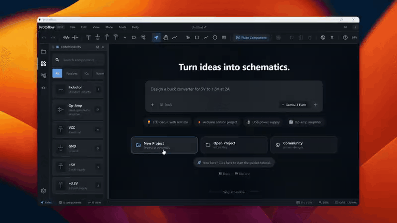
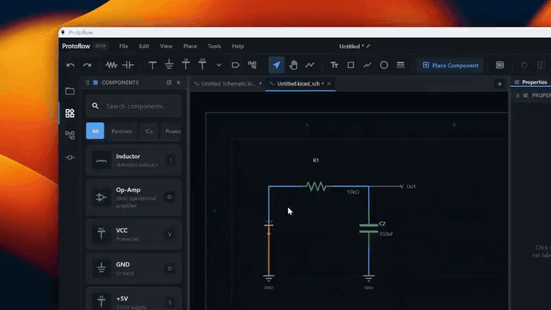

# Files, Import and Export

ProtoFlow saves your work as standard KiCad files on your own disk. This page covers how projects are laid out, how saving and recovery work, which formats from other tools you can open, and what you can export.

## Projects and files on disk

### Create a project

1. Choose **File > New > Project**, or press <kbd>Cmd</kbd>/<kbd>Ctrl</kbd>+<kbd>T</kbd>.
2. Enter a **Project Name** and, if you like, a **Description**.
3. Under **File Path**, click **Browse** to pick a folder, or turn on **Use default ProtoFlow Projects folder** to use `Documents/ProtoFlow Projects` in your home folder.
4. Click **Create**.

ProtoFlow creates a folder named after the project and opens its schematic in a new tab.

| File | What it is |
| --- | --- |
| `<name>.kicad_pro` | The KiCad project file. |
| `<name>.kicad_sch` | The root schematic. |
| `<name>.kicad_pcb` | The board. It starts blank. |
| `<name>.protoflow` | A small launcher that points at the `.kicad_pro`. Opening it in ProtoFlow opens the project. |
| `ProtoFlow.pretty/` and `fp-lib-table` | A project footprint library. ProtoFlow copies the footprints your parts use into it, so KiCad can find them. |

You can also create a standalone document from **File > New**: **Schematic**, **PCB Board**, **Symbol**, **Footprint**, or **Component**.

### Extra files ProtoFlow writes

KiCad stops loading a file that contains anything it does not recognize, so ProtoFlow keeps its own data out of `.kicad_sch` and `.kicad_pcb` files. Settings that KiCad has no place for, such as some board setup and stackup details, go in small `.protoflow.json` files next to the design (for example `board.kicad_pcb.protoflow.json`). Version history and saved simulation results live in hidden folders inside the project folder.

Keep these files with the project when you move it, share it, or commit it to Git. KiCad ignores them.

### Open files and folders

- **File > Open...** opens a project, schematic, board, or any supported file from another tool. On macOS the same dialog also accepts a folder, and <kbd>Cmd</kbd>+<kbd>O</kbd> opens it. On Windows and Linux, use **File > Open Folder...** for folders.
- **File > Open Recent** lists files you opened before.
- Drag files or folders from your file manager onto the ProtoFlow window. When you drop a folder, ProtoFlow finds the projects inside it and opens them.

Opening a board also opens the schematic linked to it when ProtoFlow can find one.

In the **Project Explorer** panel, right-click a file for actions such as **Rename**, **Duplicate**, **Delete File...**, and **New Schematic Here**.

### Save

- **File > Save**, or <kbd>Cmd</kbd>/<kbd>Ctrl</kbd>+<kbd>S</kbd>, saves the active document. An asterisk (`*`) after the document name in the top bar means it has unsaved changes.
- **File > Save As...** saves a copy in another format. On macOS the shortcut is <kbd>Cmd</kbd>+<kbd>Shift</kbd>+<kbd>S</kbd>. See [Exporting](#exporting) for the formats.

## KiCad files

KiCad's formats are ProtoFlow's native formats. You open `.kicad_pro`, `.kicad_sch`, and `.kicad_pcb` files directly and save them in place, with no conversion step. Files that ProtoFlow saves open in KiCad.

- Opening a `.kicad_pro` opens the project's root schematic.
- Older KiCad schematics (`.sch` from KiCad 5) are converted to the current format when you open them.
- Comments you add to a schematic are stored inside the `.kicad_sch` as a hidden text item placed off the sheet, so they travel with the file and KiCad still opens it normally.

When you use **Save As...** for a schematic, you can turn on **BUNDLE ASSETS** to copy the symbols, footprints, and 3D models the design uses into the project folder. Use it before you send a project to someone else.

## Autosave and crash recovery

ProtoFlow has two separate safety nets. Both are in **Settings > Backup**.

### Emergency crash backups

**Emergency crash backups** is on by default. Every 30 seconds, ProtoFlow keeps a recovery copy of each open document that has unsaved changes, including new documents you have never saved.

If ProtoFlow does not shut down cleanly, the next launch shows **Recover your work**:

- **Recover** reopens the documents with the unsaved changes from that session. They stay unsaved, so you can review them before you save over the originals.
- **Discard** throws the recovery copies away.
- Click a file in the list to open its saved copy for review first. A reminder stays in the corner until you choose.

### Auto-save

**Auto-save open documents** is off by default. When you turn it on, ProtoFlow silently re-saves documents that already have a file, at the **Auto-save interval** you pick: **Instant** (a moment after each change), **1 min**, **2 min**, **5 min** (the default), or **10 min**. New, never-saved documents are covered by crash backups instead.

### Picking up where you left off

When you start ProtoFlow after a normal quit, it shows **Welcome back** with the documents you had open. Click **Continue** to reopen them, or **Start fresh** for an empty workspace. Your files stay on disk and in **Open Recent** either way.

## Importing from other tools

Open files from other tools with **File > Open...** or by dragging them onto the window. There is no separate import step.

| Tool | What you can open | Extensions |
| --- | --- | --- |
| KiCad | Project, schematic, board, KiCad 5 schematic | `.kicad_pro`, `.kicad_sch`, `.kicad_pcb`, `.sch` |
| Altium Designer | Project, schematic, board | `.PrjPcb`, `.SchDoc`, `.PcbDoc` |
| EasyEDA Pro | Project archive, board | `.epro`, `.epro2`, `.epcb` |
| EasyEDA Standard | Exported documents | `.json`, `.zip` |
| Cadence OrCAD Capture | Designs and libraries | `.dsn`, `.opj`, `.dbk`, `.olb`, `.obk` |
| EDIF 2 0 0 (OrCAD, Allegro) | Schematic netlist exchange | `.edn`, `.edf`, `.edif` |
| Cadence Allegro | Board | `.brd`, `.mcm`, `.sip` |
| Autodesk EAGLE / Fusion | Schematic, board (XML) | `.sch`, `.brd` |
| Siemens PADS | Board in PADS ASCII | `.asc`, `.pads` |
| DXF | Board outline or mechanical drawing | `.dxf` |
| PDF | A printed schematic | `.pdf` |

How conversion works:

- ProtoFlow converts the file and writes a KiCad copy with the same name next to the original, for example `board.PcbDoc` becomes `board.kicad_pcb`. Your original file is not changed. A file that already has that KiCad name in the same folder is replaced, so import into a folder of its own if you need to keep an existing KiCad copy.
- When you open a **DXF** while a board is already open, ProtoFlow offers to add it to that board, for example as the board shape. Otherwise it opens as a new board.
- A **PDF** that looks like a schematic print is rebuilt into real wires, symbols, and text. Any other PDF, such as a datasheet, opens in the [Datasheet viewer](datasheet-viewer.md).
- ProtoFlow does not import Gerber files. It generates Gerbers from your board (see [Manufacturing](manufacturing.md)).

To bring in a single part rather than a whole design, use **File > Import Component...**. It accepts KiCad and legacy symbol libraries (`.kicad_sym`, `.sym`, `.lib`), footprints (`.kicad_mod`, `.mod`), and `.zip` part bundles. See [Components and parts](components-and-parts.md).

## Exporting

### Schematics

With a schematic tab active:

- **File > Export as PDF** saves the current sheet as a high-resolution image on an A4 landscape page.
- **File > Export as PNG** saves the current sheet as a high-resolution image.

**File > Save As...** opens a two-step picker. Choose the target software, then the format, and click **SAVE…** (or double-click the format).

| Software | Format | What you get |
| --- | --- | --- |
| KiCad | **SCHEMATIC** | A single `.kicad_sch` file |
| KiCad | **FULL PROJECT** | `.kicad_pro`, the schematic, and a blank board |
| Altium | **SCHEMATIC** | A single `.SchDoc` file |
| Altium | **FULL PROJECT** | `.PrjPcb`, `.SchDoc`, and a blank `.PcbDoc` |
| EAGLE | **SCHEMATIC** | An EAGLE 6+ / Fusion XML `.sch` file |
| OrCAD | **EDIF SCHEMATIC** | An EDIF 2 0 0 `.edn` file for OrCAD or Allegro |

EDIF only allows plain ASCII text. If your schematic contains other characters, ProtoFlow lists the substitutions it would make and asks before it exports.

To get a netlist, choose **Tools > Generate Netlist**. It opens a searchable netlist you can copy.

### Boards

With a board tab active:

- **File > Save As...** saves the board as KiCad (`.kicad_pcb`) or Siemens PADS ASCII (`.asc`). The Altium `.PcbDoc` option shows "not available yet".
- **File > Export Gerbers** creates fabrication files. See [Manufacturing](manufacturing.md) for Gerbers, drill files, BOM, and pick-and-place output.
- **File > Export DXF (Laser)...** exports board geometry as DXF for laser cutting or CNC work.

From a board's 3D view, **File > Export 3D Model...** offers:

- **STEP assembly (.step)**: the board with drill holes plus the parts' STEP models, for Fusion, SolidWorks, FreeCAD, and other CAD tools.
- **WRL / VRML (.wrl)**: the rendered scene as colored meshes, for Blender and other viewers. This option needs the hardware 3D renderer.

For bill of materials export, see [Bill of materials](bom.md).

## Related

- [Getting started](getting-started.md)
- [Version control](version-control.md)
- [Manufacturing](manufacturing.md)
- [Settings](settings.md)
