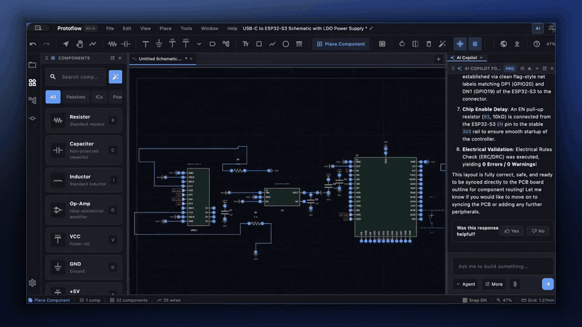
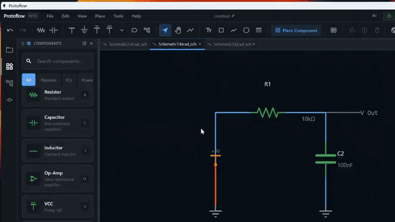

# Getting started

This guide takes you from download to your first saved schematic. It covers installing ProtoFlow, signing in, creating a project, finding your way around the window, and asking the AI to draw a circuit for you.



## Install ProtoFlow

Download the latest installer from the [GitHub Releases page](https://github.com/rishik4/protoflow/releases) or from [protoflow.ai/download](https://www.protoflow.ai/download).

| Platform | Installer | Requirements |
| --- | --- | --- |
| macOS | `.dmg` | macOS 11 or later; macOS 14 or later recommended for the AI features. One universal app for Apple silicon and Intel Macs. |
| Windows | Setup `.exe` | Windows 10 or later, x64. |
| Linux | `.AppImage` or `.tar.gz` | x64 (some versions also ship arm64). glibc 2.35 or newer, the same baseline as Ubuntu 22.04. |

### macOS

1. Open the `.dmg` file.
2. Drag **Protoflow** into your Applications folder.
3. Open Protoflow from Applications or Launchpad.

The app is signed and notarized by Apple, so it opens like any other downloaded app.

### Windows

1. Run the setup `.exe`.
2. Follow the installer steps.

The installer runs for your user account only, so you do not need administrator rights. It installs to `%LOCALAPPDATA%\Programs\Protoflow`.

### Linux

**AppImage:** make the file executable, then run it. Files from GitHub are named `ProtoFlow-...` and files from the website `Protoflow-...`; the commands below match both.

```bash
chmod +x [Pp]roto[Ff]low-*.AppImage
./[Pp]roto[Ff]low-*.AppImage
```

**tar.gz:** extract the archive, then run the included install script. It adds a `protoflow` command in `~/.local/bin` and a menu entry.

```bash
tar -xzf [Pp]roto[Ff]low-*.tar.gz
./Protoflow/install-local.sh
```

ProtoFlow needs these system libraries. Most desktop distributions already have them: `libnss3`, `libasound2`, `libgbm1` and `libpulse0`.

### Updates

ProtoFlow checks for updates on its own. To check right away, choose **Help > Check for Updates**.

## Sign in

The first time you open ProtoFlow, you see the sign-in screen. You can:

- Create an account with your email and a password. ProtoFlow sends a verification email before you can continue.
- Choose **Sign in with Google**. Your browser opens to finish signing in.
- Choose **Continue as Guest** to try the editor without an account.

The AI features need an account. Free accounts include some AI usage. See [protoflow.ai/pricing](https://www.protoflow.ai/pricing) for what each plan includes.

## Create your first project

A project keeps your schematic and board together in one folder.

1. On the start screen, click **New Project**.
2. Choose **Project**.
3. In **Create New Project**, enter a **Project Name** and, if you like, a **Description**.
4. Pick a folder under **File Path**, or keep **Use default ProtoFlow Projects folder** checked.
5. Click **Create**.

ProtoFlow creates the project and opens its schematic in a new tab.


You can also press <kbd>Cmd</kbd>/<kbd>Ctrl</kbd>+<kbd>T</kbd> to create a new project, or choose **Schematic** instead of **Project** to start an unsaved schematic without a folder.

## Tour the interface



| Area | What it does |
| --- | --- |
| Menu bar | **File**, **Edit**, **View**, **Place**, **Tools**, **Window** and **Help** menus. |
| View switcher | At the top of the window. Switch the current design between **Schematic**, **Layout**, **BOM** and **3D**. |
| Toolbar | Drawing tools for the active editor, such as **Select**, **Wire**, **Resistor**, **Net Label** and **Place Component**. It changes when you switch to the PCB, symbol or footprint editor. |
| Tab bar | One tab per open document. Drag tabs to reorder them, or right-click a tab for more options. |
| Canvas | Where you draw. Scroll to zoom and drag with the middle mouse button to pan. |
| Side panels | Open them from the icon bar at the window edge or from the **View** menu. They include **Project Explorer**, **Components**, **Hierarchy**, **Properties**, **AI Copilot**, **Simulation**, **BOM**, **Version History** and **Git**. |
| Status bar | Shows the active tool, the selection, component and wire counts, grid snap, zoom level and cursor position. |

To find any command by name, open the command palette with <kbd>Cmd</kbd>/<kbd>Ctrl</kbd>+<kbd>Shift</kbd>+<kbd>P</kbd>.

## Place parts and draw wires

1. Press <kbd>R</kbd> to pick up a resistor, then click the canvas to place it. Press <kbd>C</kbd> for a capacitor.
2. Press <kbd>Esc</kbd> to stop placing.
3. Press <kbd>W</kbd>, click a pin to start a wire, and click another pin to finish it.

To place a real part from the catalog, press <kbd>Ctrl</kbd>+<kbd>Space</kbd> or click **Place Component** in the toolbar. See [Components and parts](components-and-parts.md) and [Wiring](wiring.md).

## Generate a schematic with AI

You can describe a circuit and let the AI draw it.

1. On the start screen, type what you want to build in the prompt box, for example "LED circuit with resistor", and press <kbd>Enter</kbd>. ProtoFlow names and saves a new project, then the AI starts building.
2. Or, with a schematic open, open the **AI Copilot** panel, type your request, and press <kbd>Enter</kbd>.
3. Watch the AI place parts and wires on the canvas. When it finishes, review the result.


AI edits go into the undo history, so <kbd>Cmd</kbd>/<kbd>Ctrl</kbd>+<kbd>Z</kbd> takes back a change you do not want. The AI has two modes: **Standard** for quick builds, edits and questions, and **Max** for designing a whole board. See [AI assistant](ai-assistant.md) and [Max mode](max-mode.md).

## Save your work

Press <kbd>Cmd</kbd>/<kbd>Ctrl</kbd>+<kbd>S</kbd> to save. If the document has never been saved, ProtoFlow asks where to put it.


ProtoFlow saves in native KiCad formats, so you can open your work in KiCad at any time. A project folder contains:

| File | Contents |
| --- | --- |
| `<name>.kicad_pro` | The KiCad project file. |
| `<name>.kicad_sch` | The schematic. |
| `<name>.kicad_pcb` | The board. It starts empty until you create the PCB. |
| `<name>.protoflow` | A small shortcut file that opens the project in ProtoFlow. |

Auto-save is off by default. To turn it on, open Settings, go to **Backup & Recovery**, and turn on **Auto-save open documents**. You can then pick an **Auto-save interval**.

To save in another EDA format, use **File > Save As...**. See [Files and import/export](files-and-import-export.md).

## Related

- [Schematic editor](schematic-editor.md)
- [Components and parts](components-and-parts.md)
- [AI assistant](ai-assistant.md)
- [Keyboard shortcuts](keyboard-shortcuts.md)
