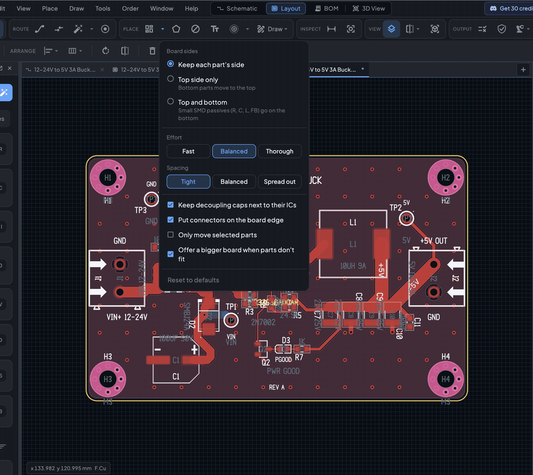
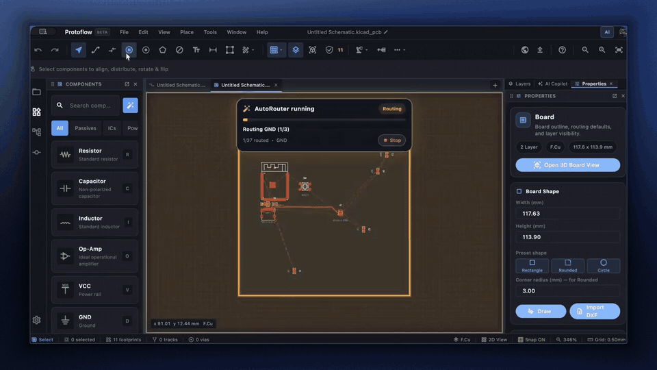
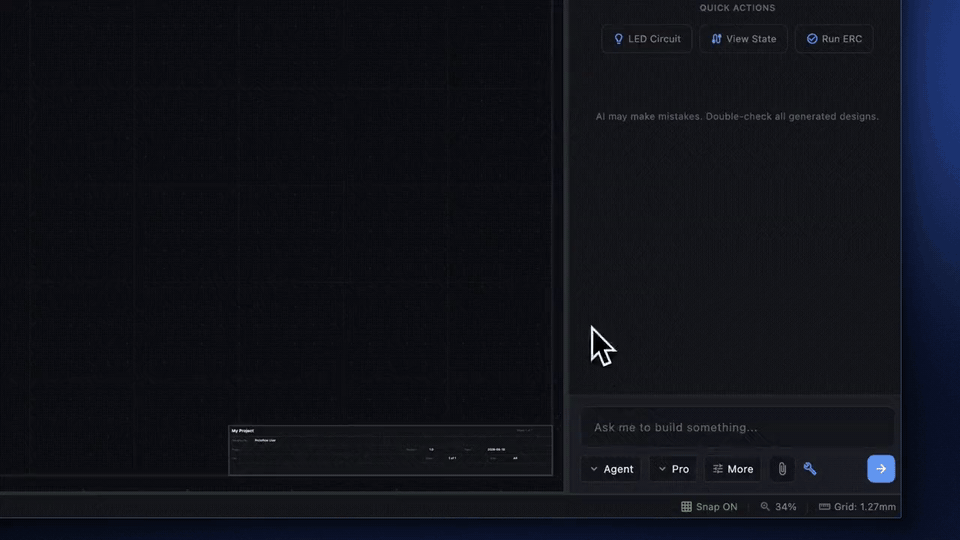

# Auto-place and autoroute

ProtoFlow can arrange the parts on your board and route the copper for you. Use these tools to get a first layout quickly, then finish by hand in the [PCB editor](pcb-editor.md) or ask the AI to help.

## Auto-Place

Auto-Place arranges every footprint inside the board outline. It keeps decoupling capacitors near their ICs, puts connectors on the board edge, and checks that the result is clean before it changes anything.

1. Draw the board outline first. See [Board outline and shape](pcb-editor.md#board-outline-and-shape).
2. Click the Auto-Place button in the **Place** section of the PCB toolbar. You can also click **Auto-Place Components** in the Autoroute panel.
3. Auto-Place runs in the background, so you can keep working. Click the button again to stop it; the board is left unchanged.
4. When it finishes, a message says how many parts moved. If the board has copper zones, press <kbd>B</kbd> to refill them.

The board needs at least two footprints. If you edit the board while Auto-Place is still working, it throws its result away and leaves the board as it was, so run it again.

### When the parts don't fit

Auto-Place keeps your board outline. If the parts don't fit, it asks **Enlarge the board?** and shows the size it needs:

- **Keep size** leaves the board and the parts as they are.
- **Enlarge board** makes the board bigger and places the parts.

### Parts that stay put

Auto-Place never moves mounting holes or [locked parts](pcb-editor.md#lock-parts-in-place). To lock parts, select them and press <kbd>Cmd</kbd>/<kbd>Ctrl</kbd>+<kbd>L</kbd>, right-click and choose **Lock in Place**, or click **Lock selected** in the Autoroute panel.

### Auto-Place options

Available in ProtoFlow 3.2.1 and later.

Click the small arrow next to the Auto-Place button (or the options button next to **Auto-Place Components** in the Autoroute panel). ProtoFlow remembers your choices.

| Option | Choices |
|---|---|
| **Board sides** | **Keep each part's side** (default), **Top side only** (bottom parts move to the top), or **Top and bottom** (small SMD resistors, capacitors, inductors and ferrite beads go on the bottom) |
| **Effort** | **Fast**, **Balanced** (default) or **Thorough**. Thorough tries more layouts and test-routes the best ones. |
| **Spacing** | **Tight** (default), **Balanced** or **Spread out** |
| **Keep decoupling caps next to their ICs** | On by default |
| **Put connectors on the board edge** | On by default |
| **Only move selected parts** | Off by default. Turn it on to rearrange just the parts you selected. |
| **Offer a bigger board when parts don't fit** | On by default |

**Reset to defaults** puts every option back.

### Other placement commands

The command palette (<kbd>Cmd</kbd>/<kbd>Ctrl</kbd>+<kbd>Shift</kbd>+<kbd>P</kbd>) also has **Place Footprints on Board**, which gives every footprint a first position, and **Optimize Footprint Layout**, which improves an existing placement.

## Autorouter

The autorouter routes the unrouted connections (airwires) on your board.

- Click **Run Autorouter** in the **Route** section of the PCB toolbar, or **Auto Route Board** in the Autoroute panel.
- To stop, click the same button (**Stop Autoroute**). ProtoFlow asks **Stop routing?**: choose **Keep progress** to keep the routes finished so far, **Discard** to drop this run's changes, or **Keep routing** to carry on.

### The Autoroute panel

Open it from the arrow next to the autorouter button and choose **Autoroute panel**.

- **Preset**: **Single layer (no vias)**, **Fast 2-layer**, **Balanced 2-layer**, **Multilayer with planes** or **Aggressive reroute**.
- **Routing Layers**: the copper layers the router may use. At least one stays selected.
- **Advanced**:
  - **Route only unrouted nets**
  - **Preserve manual copper**, so your own tracks are kept
  - **Allow vias**
  - **Aggressive rip-up**
  - **Repair planes**
  - **Stitch GND vias**
  - **Grid step**, from 0.25 to 1 mm
  - **Plane nets (comma separated)**, for nets that should become copper planes, with **Apply**, **Repair** and **Stitch GND** buttons

**Plan Planes** in the **One Click** section suggests which nets should become copper planes.

### After a run

The **Last Run** section shows the completion percentage, the tracks and vias added, rip-ups, runtime, and how many connections remain. If some nets could not be routed, they are listed under **Unrouted Nets** and marked on the board. Choose **Dismiss failure markers** from the autorouter arrow menu to clear the marks.

Route the remaining connections by hand, or change the placement and run the autorouter again. Then run DRC. See [Design checks](design-checks.md).

## Ask the AI

The AI assistant works on boards too. In a PCB tab, you can ask it to place parts, route the board, add a ground pour, or fix the problems DRC finds.

- **Standard** mode handles quick edits and questions.
- **Max** mode builds a whole board from one description: it picks real parts, draws the schematic, lays out and routes the PCB, and checks the result.

The AI asks before it moves a locked part. Click **Unlock & continue** to let it, or **Keep locked** to keep the part where it is.

See [AI assistant](ai-assistant.md) and [Max mode](max-mode.md).

## Schematic cleanup

In a schematic, **Cleanup** (<kbd>Cmd</kbd>/<kbd>Ctrl</kbd>+<kbd>U</kbd>, or the button in the schematic toolbar) finds dangling wires, net labels that connect to nothing, stray no-connect markers, unconnected power symbols and duplicate power connections. It lists what it found so you can remove items one by one or all together. It skips any change that would add a new ERC or DRC problem.

## Related

- [PCB editor](pcb-editor.md)
- [Design checks](design-checks.md)
- [Max mode](max-mode.md)
- [Manufacturing](manufacturing.md)
