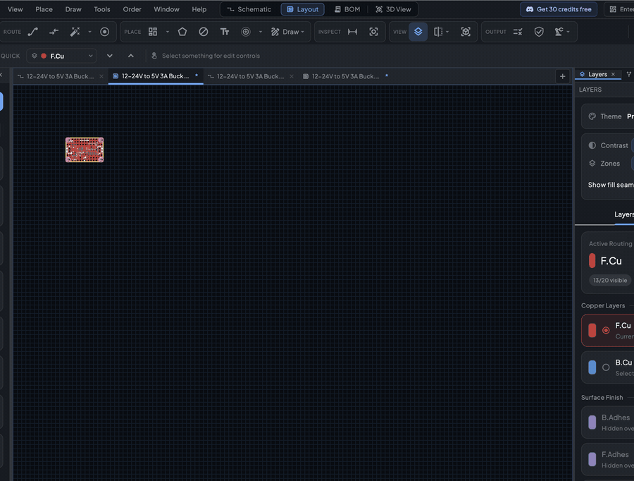

# Manufacturing

When the board is finished, ProtoFlow makes the files a board house needs: Gerbers, a drill file, and a BOM and pick-and-place file for assembly. You can also send the board straight to PCBWay for a quote.

## Before you export

1. Run DRC and fix what it finds. See [Design checks](design-checks.md).
2. Make sure the board outline is one closed shape.

When you export from the PCB toolbar and the board still has DRC errors or warnings, ProtoFlow asks **Export With DRC Issues?** and lists them. Choose **Review DRC** to open the results, **Continue Anyway** to export, or **Cancel**.

Every export also runs a preflight check. If the board has something that can't be made, such as a missing or open outline, an outline that crosses itself, or loose lines on Edge.Cuts, you see **Gerber Export Blocked** with the list of problems. Fix them and export again. Copper zones are refilled automatically during export.

## The Fabrication outputs menu

All manufacturing outputs are in the **Fabrication outputs** menu, the last button in the **Output** section of the PCB toolbar:

| Item | What it does |
|---|---|
| **Gerber Viewer…** | Preview the Gerbers and drill file for this board |
| **Export Gerbers…** | Save the Gerber and drill files as a ZIP |
| **Export DXF (Laser)…** | Save layers as DXF for a laser cutter or CNC mill |
| **Order on PCBWay…** | Upload the board to PCBWay and open the quote page |
| **Export BOM / Pick & Place…** | Save the assembly BOM and pick-and-place files |

**Export Gerbers** and **Export DXF (Laser)** are also in the **File** menu while a board tab is active.

## Gerber and drill files

Click **Export Gerbers…** and choose where to save. ProtoFlow writes one ZIP, named `<board>-gerbers.zip`, with:

| Layer | File |
|---|---|
| Top copper | `<board>-F_Cu.gtl` |
| Bottom copper | `<board>-B_Cu.gbl` |
| Inner copper | `<board>-In1_Cu.g2`, `<board>-In2_Cu.g3`, and so on |
| Solder mask | `<board>-F_Mask.gts`, `<board>-B_Mask.gbs` |
| Solder paste | `<board>-F_Paste.gtp`, `<board>-B_Paste.gbp` |
| Silkscreen | `<board>-F_Silkscreen.gto`, `<board>-B_Silkscreen.gbo` |
| Board outline | `<board>-Edge_Cuts.gm1` |
| Job file | `<board>-job.gbrjob` |
| Drill | `<board>.drl` |

The Gerbers are RS-274X with X2 attributes, in millimetres. The drill file is metric Excellon. Plated and non-plated holes are in the same file, marked per tool, and oval holes are written as routed slots. A two-layer board gives 11 files.

To check the output before you send it, open **Gerber Viewer…**. It shows the files ProtoFlow would export for the current board. Switch between **Top**, **Bottom** and **All** (<kbd>T</kbd>, <kbd>B</kbd>, <kbd>A</kbd>), turn layers on and off, and measure with <kbd>M</kbd>.

## Assembly files (BOM and pick-and-place)

For assembled boards, click **Export BOM / Pick & Place…**. The **MANUFACTURING EXPORT REVIEW** dialog lists every placed part with its reference, value, footprint, MPN, LCSC number, side, rotation and position.

1. Choose the **Assembly format**: **PCBWay** (the default), **JLCPCB** or **NextPCB**.
2. Check the status of each part. **Ready** parts are fine. **Missing Part #**, **Unmatched** and **Warning** rows need a look, for example a part with no manufacturer or LCSC part number. Use the **All**, **Ready** and **Needs Review** filters to find them.
3. Click **Choose Folder** to pick where the files go.
4. Click **Export BOM + Pick & Place**.

ProtoFlow writes two CSV files, `<board>_BOM_<format>.csv` and `<board>_PickAndPlace_<format>.csv`. Positions are in millimetres. Rotation is the footprint's own angle, so check it against your board house's preview. In the JLCPCB and NextPCB formats, parts marked do-not-populate are left out of both files. In the PCBWay format they stay in the BOM, marked as DNP.

The parts list comes from the linked schematic, so link the board to its schematic first.

## Order boards from PCBWay

ProtoFlow orders boards through PCBWay. Click **Order on PCBWay…** in the **Fabrication outputs** menu, or open the **Order** menu in the menu bar (shown while a board tab is active) and choose **Order on PCBWay…**.

1. ProtoFlow runs the same DRC and preflight checks as Gerber export.
2. It builds the Gerbers and, if the board has placed parts, the PCBWay BOM and pick-and-place files.
3. It uploads them to PCBWay along with the board size and layer count.
4. Your browser opens PCBWay's quote page with the files already attached.

You choose options, pay and track the order on pcbway.com. Nothing is charged in ProtoFlow. If the quote page doesn't open on its own, click **Open PCBWay** in the message.

The first time you open a board, ProtoFlow shows a short PCBWay announcement. **Show where to order** points you to the **Order** menu.

If you prefer another board house, export the Gerbers and assembly files and upload them on that site.

## Other exports

- **DXF**: **Export DXF (Laser)…** lets you choose layers (copper, board outline, drill holes, paste, mask openings, silkscreen) and how copper is drawn (**Inverted etch mask**, **Isolation outlines** or **Copper as drawn**), with an option to mirror. The file is in millimetres.
- **3D model**: in the 3D view, use the export button or **File > Export 3D Model...** to save the board as STEP or WRL. See [PCB editor](pcb-editor.md#3d-view).

## Related

- [Design checks](design-checks.md)
- [PCB editor](pcb-editor.md)
- [BOM](bom.md)
