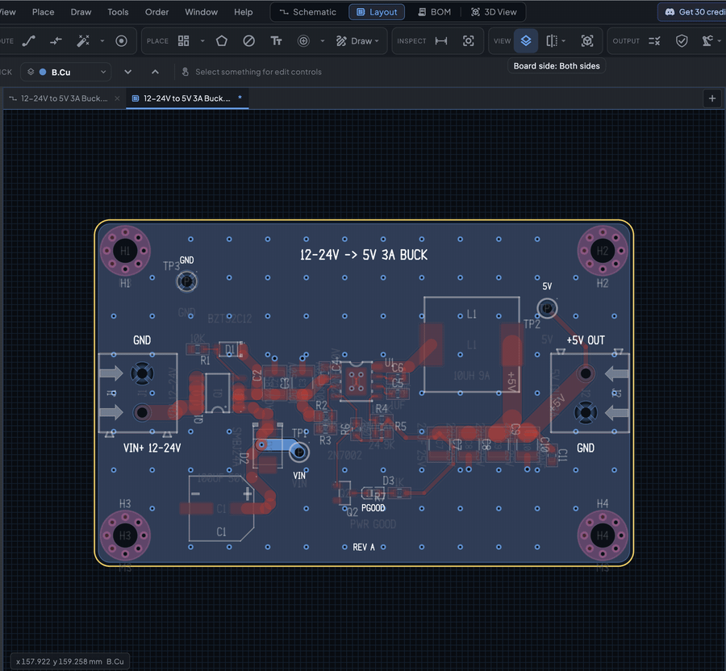
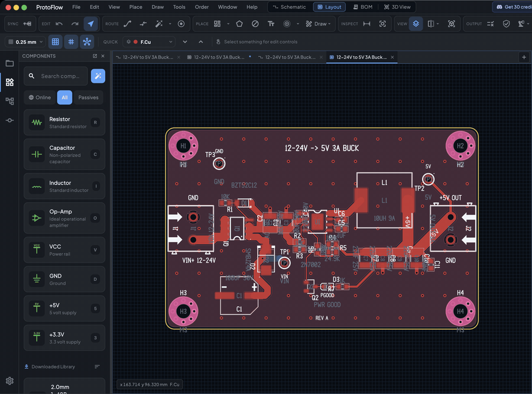
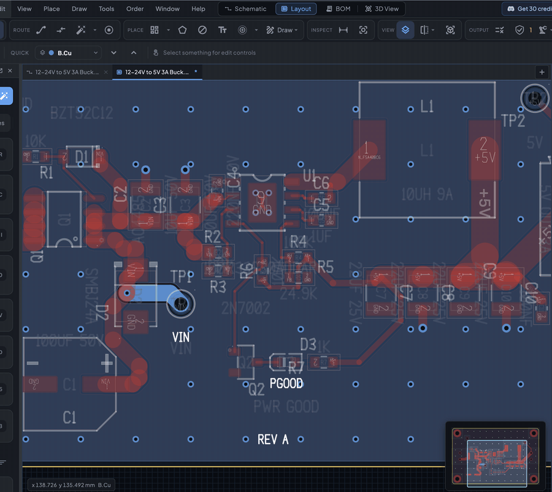

# PCB editor

The PCB editor turns your schematic into a physical board. You bring the footprints across from the schematic, draw the board outline, place parts, route copper, add pours, and check the result in 3D.

## Open a board

Every board is linked to a schematic. To open or create the layout for the schematic you are working on, click **Layout** in the view switcher at the top of the window, or click **Generate PCB** in the schematic toolbar. The view switcher also moves between **Schematic**, **Layout**, **BOM** and **3D View** for the same design.

When ProtoFlow creates a board, it first checks that every part has a footprint. Parts without one are listed under **Missing footprint links**, so you can link or replace a footprint before the board is made.

### Sync from the schematic

The board gets its footprints and nets from the schematic. When you change the schematic, click the sync button at the left end of the PCB toolbar. On an empty board its tooltip reads **Import Footprints From Linked Schematic**; after that it reads **Sync From Schematic**.

1. The **PCB Sync Review** dialog lists what will change, grouped into **Added footprints**, **Removed footprints**, **Net updates** and **Removed routes**.
2. Tick the changes you want and click **Apply**. Click **Cancel** to leave the board as it is.

If nothing changed, ProtoFlow tells you the PCB is already in sync.

## The toolbar

The PCB toolbar is grouped into sections:

| Section | What it holds |
|---|---|
| **Sync** | Sync From Schematic |
| **Edit** | Undo, Redo, **Select** |
| **Route** | **Route**, **Route Diff Pair**, the autorouter and its options, **Via** |
| **Place** | Auto-Place and its options, **Copper Zone**, **Keep-Out**, **Text**, **Mounting Hole**, the **Draw** menu |
| **Inspect** | **Measure**, **Set Origin** |
| **View** | **Layer Manager**, the board-side button, **Open 3D Board View** |
| **Output** | **Board Setup**, **Run Design Rule Check**, the **Fabrication outputs** menu |

A second row appears under the toolbar when the current tool or selection has its own options, for example trace width while routing or align and distribute when several items are selected.

Most actions are also in the command palette (<kbd>Cmd</kbd>/<kbd>Ctrl</kbd>+<kbd>Shift</kbd>+<kbd>P</kbd>).

## Board outline and shape

A new board starts with no outline. The empty canvas offers **Rectangle**, **Circle** and **Draw** to start one.

- **Draw**: click each corner, then press <kbd>Enter</kbd> to finish. <kbd>Backspace</kbd> removes the last corner and <kbd>Esc</kbd> cancels.
- **Import DXF**: open the **Draw** menu in the toolbar and choose **Import DXF…** to bring in a mechanical outline.

To change an existing outline, click the board edge with the **Select** tool. The context row shows:

- **Edit Outline**: drag corners and edges to reshape the board. You can also double-click the border, or press <kbd>O</kbd>.
- **Draw New**: trace a new outline by clicking corners.
- **Rectangle**, **Rounded**, **Circle**: replace the outline with a preset shape.
- **Delete Outline**: remove the outline. You can undo this.

While editing the outline, select a corner or an edge to get **Add Point**, **Delete Point**, **Delete Edge**, **Curve Edge** (or **Straighten**), **Round Corner** (or **Square Corner**) and **90° Snap**.

You can also build the outline from drawn shapes: select them, right-click and choose **Create Board Outline from Selection**.

## Layers

### Copper layers and stackup

Open **Board Setup** from the **Output** section of the toolbar. Under **Essentials**, **Copper layers** sets the layer count: any even number up to 32. Adding layers keeps your work and inserts empty inner layers. The **Stackup** page shows the layer stackup to scale.

### Active layer

New tracks, vias and zones go on the active copper layer. To change it:

- Pick it from the active-layer drop-down in the toolbar.
- Press <kbd>1</kbd> for the top layer, <kbd>2</kbd> for the bottom, and <kbd>3</kbd> or <kbd>4</kbd> for the first two inner layers.
- Press <kbd>Page Up</kbd> or <kbd>Page Down</kbd> to step through the copper layers.

### Layer Manager

Click **Layer Manager** in the toolbar, or press <kbd>L</kbd> when you are not routing. It lists every layer with its color and a visibility toggle, and marks the active one. Below the layers you can show or hide object types such as tracks, vias, pads, zones, ratsnest, drill holes, reference and value text, and DRC markers. Press <kbd>H</kbd> on the canvas to cycle the layer contrast.

### View one side of the board

Available in ProtoFlow 3.2.1 and later.

Use the board-side button in the **View** section of the toolbar to choose **Both sides**, **Top side only** or **Bottom side only (from below)**. The bottom view is mirrored, as if you were looking at the board from underneath, and the toolbar shows **Top** or **Bottom** while one side is shown. This only changes the view, not the board.

## Place and arrange parts

Drag footprints to move them. With parts selected:

| Action | Key |
|---|---|
| Rotate 90° | <kbd>R</kbd> |
| Flip to the other side of the board | <kbd>F</kbd> |
| Nudge | Arrow keys |
| Duplicate | <kbd>Cmd</kbd>/<kbd>Ctrl</kbd>+<kbd>D</kbd> |
| Select all | <kbd>Cmd</kbd>/<kbd>Ctrl</kbd>+<kbd>A</kbd> |
| Open properties | <kbd>E</kbd> |
| Delete | <kbd>Delete</kbd> or <kbd>Backspace</kbd> |

When more than one item is selected, the context row offers align (left, right, top, bottom, centers) and distribute (horizontally, vertically).

The properties panel lets you set the exact position, rotation and board side (**Top** or **Bottom**) of a part, and which of its text is visible.

Press <kbd>Cmd</kbd>/<kbd>Ctrl</kbd>+<kbd>F</kbd> to find a part by reference or a net by name.

To arrange the whole board automatically, see [Auto-place and autoroute](layout-automation.md).

### Lock parts in place

Available in ProtoFlow 3.2.0 and later.

Right-click a part and choose **Lock in Place**, or select it and press <kbd>Cmd</kbd>/<kbd>Ctrl</kbd>+<kbd>L</kbd>. A locked part stays where it is:

- Rotate and flip skip it, and ProtoFlow tells you it is locked.
- Auto-Place leaves it, and mounting holes, where they are.
- The AI asks before it moves a locked part. You can choose **Unlock & continue** or **Keep locked**.

To unlock, right-click the part and choose **Unlock**, or press the same shortcut again. **Lock in Place** also works on parts in the schematic.

## Route tracks

Press <kbd>W</kbd> (or <kbd>X</kbd>), or click **Route** in the toolbar. Click a pad or the end of a track to start, then click to fix each bend. If you press <kbd>W</kbd> while hovering over a pad, routing starts from that pad.

While routing:

| Key | Action |
|---|---|
| Click | Fix the route up to this point |
| <kbd>Space</kbd> or <kbd>/</kbd> | Flip the corner direction |
| <kbd>L</kbd> | Cycle the corner style: **45°**, **90°**, **Free angle**, **Rounded** |
| <kbd>V</kbd> | Add a via and continue on another layer |
| <kbd>1</kbd> to <kbd>4</kbd>, <kbd>Page Up</kbd>, <kbd>Page Down</kbd> | Change layer (adds a via) |
| <kbd>+</kbd> / <kbd>-</kbd> | Make the trace wider or narrower |
| <kbd>Tab</kbd> | Take the suggested route to the nearest target, shown as a ghost |
| <kbd>F</kbd> | Finish the route to the nearest unconnected target |
| <kbd>Backspace</kbd> or <kbd>Cmd</kbd>/<kbd>Ctrl</kbd>+<kbd>Z</kbd> | Undo the last bend |
| <kbd>Enter</kbd> | Finish the route at the cursor |
| <kbd>Esc</kbd> | Stop routing and keep what is fixed |

A strip at the bottom of the canvas reminds you of these keys while you route. Hold <kbd>Shift</kbd> to route past a pad that would otherwise snap the trace end to it.

Trace width and corner style are also in the routing context row, along with a list of saved widths. The default width comes from **Board Setup**.

### Differential pairs

Press <kbd>6</kbd> or click **Route Diff Pair** to route two traces together. The context row sets the pair width and gap, or uses the board rules.

### Edit existing copper

- Double-click a track to keep routing from it.
- Press <kbd>D</kbd> over a track to drag it.
- <kbd>U</kbd> selects the connected tracks, <kbd>I</kbd> selects all copper in the net, and <kbd>`</kbd> highlights the net.
- Right-click a track for **Set Track Width…**, **Move to Layer…** and **Unroute Net**.

## Vias

Press <kbd>V</kbd> while routing to place a via and switch layers. When you are not routing, <kbd>V</kbd> (or **Via** in the toolbar) places a free via. The **Via preset** drop-down in the routing context row sets the diameter and drill. Right-click a via for **Set Via Size…**. Board Setup holds the default via size.

## Copper zones

Copper zones (pours) are usually ground or power planes.

1. Choose the copper layer you want the pour on.
2. Press <kbd>Z</kbd>, or click **Copper Zone** in the toolbar.
3. Click each corner. Press <kbd>Enter</kbd> to close the shape.
4. Select the zone and set its net in the properties panel.

Zone properties:

| Setting | What it does |
|---|---|
| **Net** | The net the pour connects to. **None (isolated)** leaves it unconnected. |
| **Clearance** | Gap kept between the pour and other copper |
| **Min width** | Thinnest copper the pour may leave |
| **Priority** | Which zone wins where zones overlap |
| **Pads** | How pads connect: **Thermal relief**, **Solid**, **Thermal (THT only)** or **Not connected** |
| **Thermal gap**, **Spoke width** | Size of thermal relief connections |

Press <kbd>B</kbd> to refill every zone after you move parts or tracks. <kbd>Cmd</kbd>/<kbd>Ctrl</kbd>+<kbd>B</kbd> unfills them. A selected zone also has a **Refill** button in its properties, and right-clicking zones gives **Fill Selected Zones** and **Unfill Selected Zones**.

## Keep-outs, text, holes and drawings

| Tool | Key | Use |
|---|---|---|
| **Keep-Out** | <kbd>K</kbd> | Block tracks, vias or pours from an area. Choose which layers and objects it blocks in the properties panel. |
| **Text** | <kbd>T</kbd> | Click to place text, then edit the text, size, style and alignment in the properties panel. |
| **Mounting Hole** | | Click the board to place a hole, <kbd>Esc</kbd> to finish. The arrow next to the button picks the size and can add holes at every board corner. |
| **Measure** | <kbd>M</kbd> | Click two points to read the length, X and Y distance, and angle. |
| **Set Origin** | | Click a point to make coordinates relative to it. |
| **Draw** | | Lines, arcs, rectangles, circles and polygons on the layer you pick, plus **Import DXF…** |

## 3D view

Click **Open 3D Board View** in the toolbar, click **3D View** in the view switcher, or press <kbd>Option</kbd>/<kbd>Alt</kbd>+<kbd>3</kbd>. The board opens in its own 3D tab with component models. Click **Return to PCB Board** to go back.

- Drag the view cube or the scene to orbit. Click a cube face (**TOP**, **BOTTOM**, **FRONT**, **BACK**, **LEFT**, **RIGHT**) to snap to that view, for example to look at the underside of the board.
- Scroll or press <kbd>+</kbd> / <kbd>-</kbd> to zoom. **Reset default top view** brings the camera back.
- Press <kbd>Cmd</kbd>/<kbd>Ctrl</kbd>+<kbd>F</kbd> to find a part by reference.
- Click a part to adjust its 3D model. You can nudge its position and rotation, press <kbd>R</kbd> to rotate it, or click **Auto-align** to line the model up with its footprint. **Reset all 3D part offsets to default** undoes every adjustment on the board.
- The export button saves the board as STEP or WRL.

If the 3D view stays empty on your computer, open the 3D details panel and switch the renderer from **Hardware** to **Compatibility**.

## Check the board

Run **Run Design Rule Check** from the **Output** section before you make manufacturing files. See [Design checks](design-checks.md).

## Related

- [Auto-place and autoroute](layout-automation.md)
- [Footprint editor](footprint-editor.md)
- [Design checks](design-checks.md)
- [Manufacturing](manufacturing.md)
