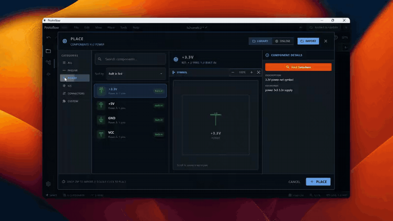
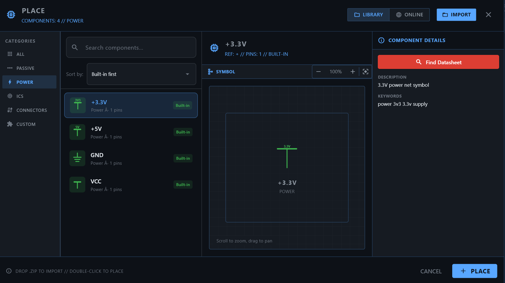

# Power and nets

Every group of connected pins is a net. This page covers power and ground symbols, net labels that connect points without a wire, and the panel that lists every net in your design.

## Power and ground symbols

Power and ground symbols connect a pin to a named supply rail. Every symbol with the same name is on the same net, so you do not need to draw wires between them.

The toolbar shows four power symbols: **VCC**, **GND**, **+5V** and **+3.3V** to start with. Click the arrow next to them (**More Power Symbols**) to open the full set. A symbol you pick there takes a place on the toolbar, and the reset button in that panel brings back the defaults. You can also use the quick keys: <kbd>V</kbd> for VCC, <kbd>D</kbd> for GND, <kbd>5</kbd> for +5V and <kbd>3</kbd> for +3.3V.

| Toolbar name | Net name | Typical use |
| --- | --- | --- |
| **VCC** | `VCC` | General positive supply |
| **VDD** | `VDD` | Positive supply, CMOS naming |
| **VIN** | `VIN` | Input voltage |
| **+5V** | `+5V` | 5 V rail |
| **+3.3V** | `+3.3V` | 3.3 V rail |
| **+12V** | `+12V` | 12 V rail |
| **VBAT (Battery)** | `VBAT` | Battery supply |
| **VBUS (USB)** | `VBUS` | USB bus power |
| **VSS** | `VSS` | Negative or ground rail, CMOS naming |
| **-5V** | `-5V` | Negative 5 V rail |
| **-12V** | `-12V` | Negative 12 V rail |
| **GND** | `GND` | Main ground |
| **Analog Ground** | `GNDA` | Ground for sensitive analog circuits |
| **Power Ground** | `GNDPWR` | Ground for high-current paths |
| **Signal Ground** | `SGND` | Signal ground |
| **Earth Ground** | `EARTH` | Protective earth |
| **Chassis Ground** | `CHASSIS` | Enclosure ground |
| **Power Flag** | `PWR_FLAG` | Tells the electrical rules check that a net is driven by a power source |

To use a different rail name, select the symbol, press <kbd>P</kbd> to open **Properties**, and change **Name** under **Net**. For symbols that offer it, **Style** switches between a **Bar** and an **Arrow** shape.

> [!TIP]
> Use separate ground symbols for analog and power sections, such as `GNDA` and `GNDPWR`. It keeps the grounds easy to tell apart when you lay out the board.

## Net labels

A net label gives a wire a name. Pins and wires that carry the same label name are connected, even when no wire joins them.

1. Press <kbd>L</kbd>, or click **Net Label** in the toolbar.
2. Click the wire or pin to label.
3. In **ADD NET LABEL**, set:
   - **Scope**: **Local** connects only on this sheet. **Global** connects across every sheet. **Hierarchical** connects to a pin on the parent sheet's sheet symbol.
   - **Label Style**: a plain **Local Label**, or a **Port/Flag** shape.
   - **Label Name**, for example `SDA` or `SPI_MOSI`.
   - **Connection Side**: **Left** or **Right**.
4. Click **ADD**.

To change a label later, select it and open **Properties**. There you can edit the **Net name**, **Scope**, **Shape** (**Text** or **Flag**), **Side**, and the signal **Direction** (**Input**, **Output**, **Bidirectional** or **Passive**).

## See your nets

Open the **Hierarchy** panel from the panel icons or the **View** menu. It has two tabs:

- **Components** lists every part, sortable by reference, type or value.
- **Nets** lists every net, grouped into **Power Nets**, **Ground Nets** and **Signal Nets**, sortable by name, pin count or component count.

Search either list from the box at the top. Next to a net, use **Highlight on canvas** to show it on the schematic, or **Select net wires** to select its wires.

To jump to a net by name, press <kbd>Cmd</kbd>/<kbd>Ctrl</kbd>+<kbd>F</kbd> and type its name.

## Check connections

ProtoFlow checks the schematic as you edit it and marks problems such as unconnected pins on the canvas. To show or hide the markers, choose **View > DRC/ERC Visuals**. To run a full check, choose **Tools > Design Rule Check**. See [Design checks](design-checks.md).

## Related

- [Wiring](wiring.md)
- [Schematic editor](schematic-editor.md)
- [Design checks](design-checks.md)
- [Simulation](simulation.md)
