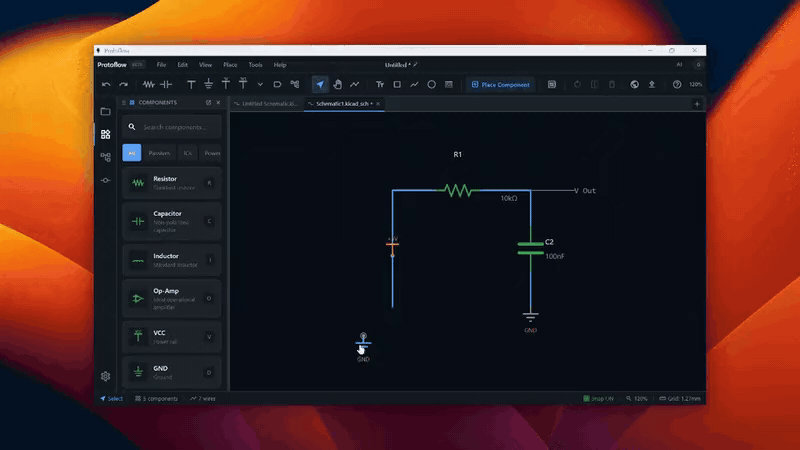

# Schematic editor

The schematic editor is where you draw circuits. This page covers moving around the canvas, selecting and editing items, the grid, undo, and working with several documents in tabs.

## Move around the canvas

| Action | Input |
| --- | --- |
| Zoom in or out | Mouse wheel, trackpad scroll, or pinch |
| Zoom in or out from the keyboard | <kbd>+</kbd> or <kbd>-</kbd> |
| Reset zoom | <kbd>Cmd</kbd>/<kbd>Ctrl</kbd>+<kbd>0</kbd> |
| Pan | Drag with the middle mouse button |
| Pan with a trackpad or one-button mouse | Hold <kbd>Cmd</kbd> (macOS) or <kbd>Ctrl</kbd> (Windows and Linux) and drag |
| Pan with a tool | Choose **Pan** in the toolbar, then drag |

On a trackpad, two-finger scrolling zooms rather than pans. To change how zooming feels, open Settings, go to **Input**, and adjust **Scroll zoom speed**, **Zoom at cursor (KiCad style)** and **Invert zoom direction**.

The canvas shows a page frame with a title block. Double-click the title block to edit the document properties, such as the title and page size.

## Select items

- **Click** an item to select it.
- **Shift+click** or <kbd>Cmd</kbd>/<kbd>Ctrl</kbd>+click to add an item to the selection or remove it.
- **Drag on empty canvas** to draw a selection box.
- **Shift+drag on empty canvas** to draw a freeform lasso around the items you want.
- Press <kbd>Cmd</kbd>/<kbd>Ctrl</kbd>+<kbd>A</kbd> to select everything.
- Press <kbd>Esc</kbd> to clear the selection.

## Edit items

| Task | How |
| --- | --- |
| Move | Drag the selection. Wires stay attached to the pins. |
| Nudge | Arrow keys move the selection one grid step. Hold <kbd>Shift</kbd> for five steps. |
| Rotate | <kbd>R</kbd> rotates clockwise. <kbd>Shift</kbd>+<kbd>R</kbd> rotates counterclockwise. |
| Mirror | <kbd>M</kbd> |
| Delete | <kbd>Delete</kbd> or <kbd>Backspace</kbd>. <kbd>Shift</kbd>+<kbd>Delete</kbd> also removes the wires connected to the selection. |
| Cut, copy, paste | <kbd>Cmd</kbd>/<kbd>Ctrl</kbd>+<kbd>X</kbd>, <kbd>C</kbd>, <kbd>V</kbd>. Pasted items follow the cursor until you click to drop them. |
| Edit properties | Select a part and press <kbd>P</kbd>, or double-click it. The **Properties** panel opens. |

Right-click on the canvas for more commands. Depending on the selection, the menu includes **Properties**, **Cut**, **Copy**, **Paste**, **Align to Grid**, **Auto Connect**, **Auto Connect Power/Ground**, **Remove Wires**, **Reset Text**, **Show on PCB**, **View PDF Data Sheet**, **Lock in Place**, **Delete** and **Ask AI about selection...**.

### Lock parts in place

Right-click a part and choose **Lock in Place** to protect its position. Locked parts are skipped when you rotate, mirror or delete a selection, and the AI asks before it moves one. Choose **Unlock** to release it.

### Alignment guides

When you drag a part, red guide lines appear when it lines up with nearby parts. Use them to keep rows and columns of parts tidy without measuring.

## Grid and snap

- Press <kbd>G</kbd> to show or hide the grid.
- Press <kbd>Cmd</kbd>/<kbd>Ctrl</kbd>+<kbd>G</kbd> to turn grid snap on or off. The status bar shows **Snap ON** or **Snap OFF**.
- To change the grid style or the default snap setting, open Settings and go to **Appearance > Grid**.
- To move off-grid items back onto the grid, choose **Edit > Align to Grid**, or right-click and choose **Align to Grid**.

## Undo and redo

| Action | Shortcut |
| --- | --- |
| Undo | <kbd>Cmd</kbd>/<kbd>Ctrl</kbd>+<kbd>Z</kbd> |
| Redo | <kbd>Cmd</kbd>/<kbd>Ctrl</kbd>+<kbd>Shift</kbd>+<kbd>Z</kbd> or <kbd>Cmd</kbd>/<kbd>Ctrl</kbd>+<kbd>Y</kbd> |

Each tab keeps its own history of the last 50 steps. Changes made by the AI are in the same history, so you can undo them the same way. For older versions of a design, use the **Version History** panel. See [Version control](version-control.md).

## Find and run commands

- Press <kbd>Cmd</kbd>/<kbd>Ctrl</kbd>+<kbd>F</kbd> to find a component or net on the current schematic. Press it again to close the find bar.
- Press <kbd>Cmd</kbd>/<kbd>Ctrl</kbd>+<kbd>Shift</kbd>+<kbd>P</kbd> to open the command palette and run any command by name.

## Work with tabs

Every open schematic, board, symbol and footprint gets its own tab, with its own undo history.

| Action | How |
| --- | --- |
| Switch to tab 1 to 8 | <kbd>Cmd</kbd>/<kbd>Ctrl</kbd>+<kbd>1</kbd> to <kbd>8</kbd> |
| Switch to the last tab | <kbd>Cmd</kbd>/<kbd>Ctrl</kbd>+<kbd>9</kbd> |
| Close the current tab | <kbd>Cmd</kbd>/<kbd>Ctrl</kbd>+<kbd>W</kbd> |
| Reopen the last closed tab | <kbd>Cmd</kbd>/<kbd>Ctrl</kbd>+<kbd>Shift</kbd>+<kbd>T</kbd> |
| Reorder tabs | Drag a tab |

Right-click a tab for **Close**, **Close Others**, **Close Tabs to the Left**, **Close Tabs to the Right**, **Close All**, **Add Tab to New Group**, **Copy Path**, **Reveal in Finder** (macOS) or **Show in Explorer** (Windows), **Rename** and **Pin Tab**. Tab groups work like browser tab groups: give a group a name and color, and collapse it to save space.

When a schematic has a board, the view switcher at the top of the window moves between its **Schematic**, **Layout**, **BOM** and **3D** views.

## Hierarchical sheets

For larger designs, split the schematic into sheets. Choose **Hierarchical Sheet** in the toolbar, click where you want the sheet symbol, and fill in the dialog that opens. Double-click a sheet symbol to open the sheet inside it. Use net labels with **Hierarchical** scope to connect signals to the sheet's pins. See [Power and nets](power-and-nets.md).

## Related

- [Components and parts](components-and-parts.md)
- [Wiring](wiring.md)
- [Annotations and regions](annotations-and-regions.md)
- [Keyboard shortcuts](keyboard-shortcuts.md)
