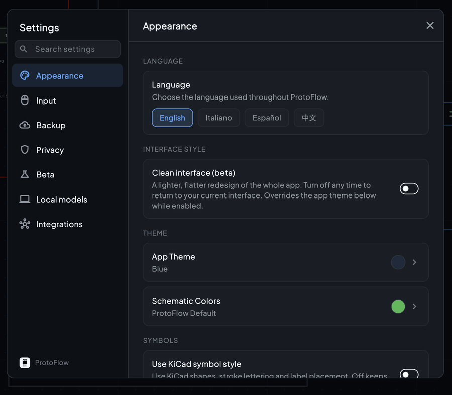

# Settings

The Settings dialog holds app-wide preferences: appearance, input, backups, privacy, beta options, and local AI models. Changes apply right away.

## Open Settings

- Click the gear icon at the bottom of the activity bar on the left edge of the window.
- Or open the command palette (<kbd>Cmd</kbd>/<kbd>Ctrl</kbd>+<kbd>Shift</kbd>+<kbd>P</kbd>) and run **Open Settings**. The palette also has commands that jump straight to one page, such as **Backup & Recovery Settings**.

The pages are listed on the left. Use the search field above them to find a setting by name or description.

## Appearance

| Section | Setting | What it does |
| --- | --- | --- |
| Language | **Language** | The language used throughout ProtoFlow: English, Italiano, Español, or 中文. |
| Interface style | **Clean interface (beta)** | A lighter, flatter redesign of the whole app. While it is on, it overrides the app theme. Turn it off any time to return to the usual interface. |
| Theme | **App Theme** | **Light**, **Dark** (pure black background), or **Blue** (dark blue background). |
| Theme | **Schematic Colors** | The schematic canvas palette: **ProtoFlow Default**, **EDA Classic**, **KiCad Original**, or a custom theme. |
| Symbols | **Use KiCad symbol style** | Draw symbols with KiCad shapes, stroke lettering, and label placement. |
| Symbols | **Rounded component body corners** | Softer corners on symbol bodies and previews. |
| Wiring | **Show wire endpoints** | Dots where wires connect to pins. |
| Wiring | **Show overview minimap** | A small overview that appears when you zoom in on a board or schematic. |
| Wiring | **Crosshair** | When to show a KiCad-style crosshair at the cursor: **Never** (default), **While wiring**, or **Always**. |
| Grid | **Grid style** | **Dots**, **Lines**, or **Off** behind the schematic. <kbd>G</kbd> cycles it. |
| Grid | **Snap to grid** | Keep parts, wires, and shapes on the schematic grid. <kbd>Cmd</kbd>/<kbd>Ctrl</kbd>+<kbd>G</kbd> toggles it. |
| Diagnostics | **Show DRC/ERC visuals** | Error highlights and red X markers on schematic and board canvases. On by default. |

See [UI customization](ui-customization.md) for themes and custom schematic colors.

## Input

| Section | Setting | What it does |
| --- | --- | --- |
| Zoom | **Scroll zoom speed** | How far each mouse wheel or scroll step zooms. |
| Zoom | **Zoom at cursor (KiCad style)** | Zoom shortcuts and **View** menu zoom bring the spot under the pointer to the middle of the canvas. |
| Trackpad | **Invert zoom direction** | Reverse the two-finger scroll direction for zooming. |
| Selection | **Single-click selects wire segment** | Off: a click selects the whole wire between junctions. On: a click selects one segment, and a double-click selects the whole wire. |
| AI Chat | **Swap queue / steer shortcuts** | While the AI is working, <kbd>Enter</kbd> queues your message and <kbd>Shift</kbd>+<kbd>Enter</kbd> sends it now. Turn this on to swap them. |
| AI Chat | **AI change log** | Adds a collapsible **Changes** card to AI edit replies that lists each change, what succeeded and what failed, with links that find each change on the schematic. |
| AI Chat | **Chime when AI finishes** | Plays a short sound when the AI finishes a run. Stopping a run yourself stays silent. |

## Backup

| Setting | What it does |
| --- | --- |
| **Auto-save open documents** | Off by default. Silently re-saves documents that already have a file. |
| **Auto-save interval** | Shown when auto-save is on: **Instant**, **1 min**, **2 min**, **5 min** (default), or **10 min**. |
| **Emergency crash backups** | On by default. Keeps a recovery copy of every open document, including unsaved new ones, and offers to restore them after a crash. |

See [Autosave and crash recovery](files-and-import-export.md#autosave-and-crash-recovery) for how recovery works.

## Privacy

| Setting | What it does |
| --- | --- |
| **Share anonymous usage analytics** | Sends usage metrics that help improve ProtoFlow. On by default. |
| **Help improve ProtoFlow AI** | Shares a privacy-scrubbed copy of the active schematic or board before and after AI runs, to diagnose problems and improve the AI. The setting's description explains exactly what is shared and for how long. |
| **Share full AI conversations for support** | Lets support staff replay your exact AI prompts and responses to reproduce a problem you reported. Turning it on asks for your consent first, and you can revoke it at any time. |

## Beta

| Setting | What it does |
| --- | --- |
| **Enable beta features** | Receive newer beta builds before general release. A stable release at the same or a newer version always takes priority. |
| **Enable Gemini CLI** | Shows Gemini CLI as a linked coding agent alongside Claude and Codex. It uses your own Gemini CLI account. |

## Local models

On a paid plan, Standard mode in the AI Copilot can use a model running on your own computer through Ollama or LM Studio. This page calls it Agent mode. Local models use no credits or usage limits, but they are slower than ProtoFlow's hosted AI, and the first reply on a long design can take a few minutes. Max mode keeps using ProtoFlow's hosted models.

1. Start Ollama or the LM Studio local server, and download a model that supports tool calling.
2. In **Settings > Local models**, enter the **Server URL** and click **Connect**.
3. Pick a **Model** from the models you have installed.
4. Optionally turn on **Think before answering** for reasoning models.

## Other pages

Some accounts see extra pages, such as **Integrations** or **API Keys**, for organization features. They are not covered in these docs.

Plans, credits, and billing are managed on your account. See [pricing](https://www.protoflow.ai/pricing) for what each plan includes.

## Related

- [UI customization](ui-customization.md)
- [Files, import and export](files-and-import-export.md)
- [Keyboard shortcuts](keyboard-shortcuts.md)
- [AI assistant](ai-assistant.md)
