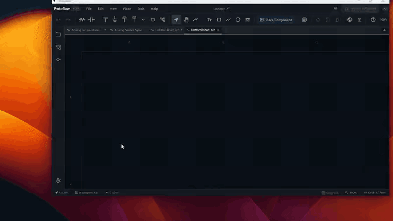

# UI Customization

You can rearrange ProtoFlow's panels, pop them out, organize tabs, and change the app theme and schematic colors. Your panel layout is saved and comes back the next time you open ProtoFlow.

## The workspace

- **Top bar**: the menus, such as **File**, **Edit**, **View**, **Place**, **Tools**, and **Help**. When a design is open, the middle of the bar has a switcher for **Schematic**, **Layout**, **BOM**, and **3D View**.
- **Tab strip**: one tab per open document.
- **Activity bar**: the column of icons on the left edge. Each icon opens a panel. The gear icon at the bottom opens [Settings](settings.md).
- **Dock zones**: panels live in a left zone, a right zone, and a bottom zone around the canvas.

| Zone | Panels that start there |
| --- | --- |
| Left | **Project Explorer**, **Components**, **Symbol Libraries**, **Hierarchy**, **Project Hierarchy**, **Git** |
| Right | **AI Copilot**, **Properties**, **Version History**, **Simulation**, **BOM**, and on boards **Layers** and **Autoroute** |
| Bottom | **ERC Results**, **Netlist**, **Console** |

Some panels only appear when they apply, for example **Layers** only for boards.

## Show and hide panels

- **View** menu: toggle **Left Panel** and **Right Panel**, or any single panel such as **Project Explorer**, **AI Copilot**, **Version History**, or **Git**.
- Activity bar: click an icon to open its panel, and click it again to collapse it. Drag icons up or down to reorder them.
- Right-click the activity bar for **Open Panel** or **Collapse Panel**, **Hide from Sidebar**, a checklist of panels to show in the sidebar, and **Hide Left Sidebar**.
- Each panel header has a **Close** button (**Collapse** for panels in the left sidebar).

## Rearrange panels

1. Drag a panel by its header or its tab.
2. Drop it where you want it:
   - On the left, right, top, or bottom edge of another panel to split that area.
   - In the middle of another panel to add it as a tab next to that panel.
   - On an empty zone where **Drop here** appears.
   - On the activity bar to add it to the left sidebar.

Drag the borders between panels to resize them.

### Pop out a panel

Click **Pop out** in a panel's header.

- On macOS the panel opens in its own window, which you can move to another display.
- On Windows and Linux it becomes a floating panel inside the ProtoFlow window.

To put it back, click **Dock back into ProtoFlow** (or **Dock panel** on a floating panel). It returns to the spot it came from.

## Tabs

Right-click a tab for:

- **Add Tab to New Group**: bundle tabs into a named, color-coded group. Click the group's colored label to collapse or expand it, and right-click the label to rename it, change its color, **Ungroup**, or **Close group**.
- **Pin Tab** (or **Unpin Tab**), **Rename**, **Copy Path**, and revealing the file in your file manager.
- **Close Others**, **Close Tabs to the Left**, **Close Tabs to the Right**, and **Close All**.
- **Move to New Window**: open the tab in a separate ProtoFlow window.

Select several tabs to apply these actions to all of them at once.

To see two documents side by side, drag a tab to the edge of the editor area and drop it. The editor splits, and you can drag the divider to resize.

| Action | macOS | Windows / Linux |
| --- | --- | --- |
| Close tab | <kbd>Cmd</kbd>+<kbd>W</kbd> | <kbd>Ctrl</kbd>+<kbd>W</kbd> |
| Reopen closed tab | <kbd>Cmd</kbd>+<kbd>Shift</kbd>+<kbd>T</kbd> | <kbd>Ctrl</kbd>+<kbd>Shift</kbd>+<kbd>T</kbd> |
| Go to tab 1 to 9 | <kbd>Cmd</kbd>+<kbd>1</kbd> to <kbd>9</kbd> | <kbd>Ctrl</kbd>+<kbd>1</kbd> to <kbd>9</kbd> |

## Themes

### App theme

Choose **View > Theme**, then **Light**, **Dark**, or **Blue**. You can also pick it in **Settings > Appearance > App Theme**, or run **Cycle App Theme** from the command palette (<kbd>Cmd</kbd>/<kbd>Ctrl</kbd>+<kbd>Shift</kbd>+<kbd>P</kbd>).

**Settings > Appearance** also has **Clean interface (beta)**, a lighter, flatter look for the whole app. While it is on, it replaces the app theme.

### Schematic colors

Choose **View > Schematic Colors**, then a palette for the schematic canvas:

- **ProtoFlow Default**
- **EDA Classic**
- **KiCad Original**
- Any custom themes you created

To make your own, choose **View > Schematic Colors > New Custom Theme...**. Give it a **Theme Name** and set colors for each group, such as **Structure**, **Wires & Labels**, **Text**, and **Pin Endpoints**, then click **Save**. To change a custom theme later, click the pencil icon next to it in the **Schematic Colors** menu.

For KiCad-style symbol drawing, turn on **Use KiCad symbol style** in **Settings > Appearance**. Board layer colors are set in the PCB editor (see [PCB editor](pcb-editor.md)).

### Full screen

On macOS, choose **View > Enter Full Screen** or press <kbd>Ctrl</kbd>+<kbd>Cmd</kbd>+<kbd>F</kbd>.

## Related

- [Settings](settings.md)
- [Keyboard shortcuts](keyboard-shortcuts.md)
- [Schematic editor](schematic-editor.md)
- [PCB editor](pcb-editor.md)
