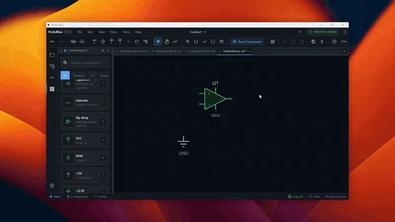
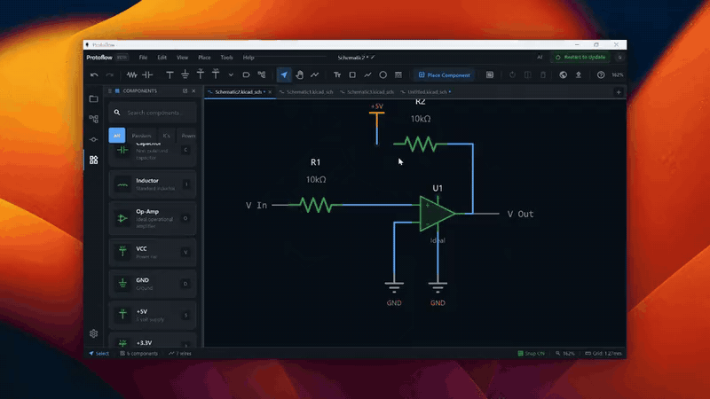

# Wiring

Wires connect pins into nets. This page covers drawing and editing wires, how ProtoFlow keeps connections intact, and the tools that wire or tidy a schematic for you.

## Draw a wire

1. Press <kbd>W</kbd>, or click **Wire** in the toolbar. You can also click a pin while the **Select** tool is active to start a wire straight away.
2. Click a pin to start the wire. You can also start on an existing wire, a net label, or empty canvas.
3. Move the cursor. The wire follows in horizontal and vertical segments.
4. Click to add a bend.
5. Click another pin, wire or net label to finish. To end the wire where you are, double-click or right-click.

While you draw:

| Key | Action |
| --- | --- |
| <kbd>Space</kbd> or <kbd>/</kbd> | Flip the corner between horizontal-first and vertical-first |
| <kbd>Backspace</kbd> or <kbd>Delete</kbd> | Remove the last segment. With no segments placed, cancel the wire. |
| <kbd>Cmd</kbd>/<kbd>Ctrl</kbd>+<kbd>Z</kbd> | Remove the last segment |
| <kbd>Esc</kbd> | Cancel the wire |

To show a crosshair cursor while you wire, open Settings, go to **Appearance**, and set **Crosshair**.

## How connections work

- **Junctions.** Where a wire ends on the middle of another wire, ProtoFlow draws a junction dot. Wires that cross without a dot are not connected.
- **Dangling ends.** A wire end that is not connected to anything is drawn with a small square, so loose wires are easy to spot.
- **Parts keep their wires.** When you move a part, the wires on its pins move with it and are re-routed with clean right-angle bends.

## Edit wires

- Click a wire to select it. By default a click selects the full wire from junction to junction, and a double-click selects one segment. To swap these, open Settings, go to **Input**, and turn on **Single-click selects wire segment**.
- Drag a selected wire or segment to move it.
- Shift+double-click a wire to simplify it and remove extra bends.
- Press <kbd>Delete</kbd> to remove the selected wires.
- To strip the wires from parts, select the parts, right-click, and choose **Remove Wires**.

## Wire parts automatically with Auto Connect

**Auto Connect** wires parts together in a chain, from left to right.

1. Select two or more parts.
2. Press <kbd>Cmd</kbd>/<kbd>Ctrl</kbd>+<kbd>J</kbd>, or choose **Edit > Auto Connect**.

With nothing selected, Auto Connect uses the parts visible in a wire-free area of the canvas. Press <kbd>Cmd</kbd>/<kbd>Ctrl</kbd>+<kbd>Shift</kbd>+<kbd>J</kbd> to auto-connect and then clean up in one step.

To wire one part to the power and ground rails, select it, right-click, and choose **Auto Connect Power/Ground**.

## Mark unused pins

Place a no-connect marker on a pin you are leaving unconnected on purpose, so the electrical rules check does not report it. Press <kbd>X</kbd> or choose **Place > No Connect**, then click the pin. To remove a marker, click it and press <kbd>Delete</kbd>.

## Clean up a schematic

**Cleanup** tidies wiring and then helps you remove leftovers.

1. Press <kbd>Cmd</kbd>/<kbd>Ctrl</kbd>+<kbd>U</kbd>, or click **Cleanup** in the toolbar. If you have a selection, cleanup works only on the selected items and what they connect to.
2. ProtoFlow tidies the wiring.
3. A **CLEANUP REVIEW** window then lists items you may want to delete: dangling wires, net labels whose name appears only once, stray no-connect markers, unconnected power symbols and duplicate power connections. Choose which ones to remove.

Cleanup changes go into the undo history, so <kbd>Cmd</kbd>/<kbd>Ctrl</kbd>+<kbd>Z</kbd> reverts them.

## Related

- [Power and nets](power-and-nets.md)
- [Schematic editor](schematic-editor.md)
- [Design checks](design-checks.md)
- [Keyboard shortcuts](keyboard-shortcuts.md)
